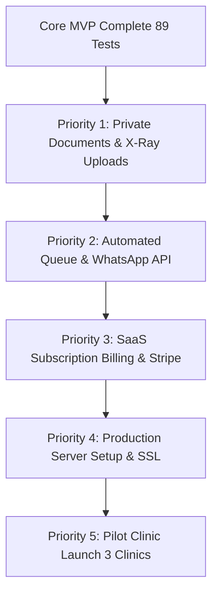

# DentalCare SaaS — Remaining Tasks & Post-MVP Production Roadmap

> **Status:** Active Roadmap & Architecture Specification  
> **Repository:** DentalCare Multi-Tenant SaaS (`d:\Dental Clinic`)  
> **Base Version:** MVP Core Complete (89/89 Tests Passed)  
> **Target Release:** Version 2.0 (Commercial Automation & Cloud Deployment)

---

## 1. Executive Summary & Audit Overview

Hamare system ka **core multi-tenant MVP** kamyabi se ban chuka hai aur locally 100% verified hai. Is waqt system mein:
- Multi-tenancy database isolation (`BelongsToClinic`)
- Role-Based Access Control (Super Admin, Clinic Admin, Dentist, Receptionist)
- Public booking portal aur online calendar conflict engine
- Patient clinical dossiers aur interactive FDI odontogram charting
- Line-item dynamic invoicing aur printable counter receipts
- Manual WhatsApp 1-click follow-up recalls
- Doctor rostering, service catalog aur financial reports
- Platform Super Owner portal (`/platform`)

Neeche user-provided specification ke mutabiq **Complete** aur **Remaining** tasks ka tafseeli audit aur remaining tasks ki mukammal implementation roadmap darj hai.

---

## 2. Feature Audit & Status Matrix

| Module / Requirement | Phase Reference | Status | Current Implementation / Notes |
| :--- | :--- | :--- | :--- |
| **Requirements & Planning** | Phase 0 | ✅ **Completed** | [docs/requirements.md](file:///d:/Dental%20Clinic/docs/requirements.md) updated with full acceptance criteria. |
| **Dev Environment & DB** | Phase 1 | ✅ **Completed** | PHP 8.3 / MySQL (`dentalcare`) running with Git version control. |
| **Multi-Tenant Schema** | Phase 2 | ✅ **Completed** | 10 Migrations, 11 Models, `BelongsToClinic` global tenant scope. |
| **Auth & RBAC Matrix** | Phase 3 | ✅ **Completed** | Multi-tenant auth, 4 distinct user roles, registration & login. |
| **Public Clinic Website** | Phase 4 | ✅ **Completed** | Branded `/clinic/{slug}` landing page, services catalog, doctor profiles. |
| **Appointment Booking Engine** | Phase 5 | ✅ **Completed** | Conflict resolution, database locks, daily/weekly calendar view. |
| **Patient Directory & Dossier** | Phase 6 | ✅ **Completed** | Patient search, tabbed dossier, clinical confidentiality mask. |
| **Document/X-Ray File Uploads** | Phase 6 (Step 6.3) | ⏳ **Remaining** | File attachments to private cloud/disk storage with signed URLs. |
| **Treatment & FDI Odontogram** | Phase 7 | ✅ **Completed** | Interactive tooth chart, multi-visit plans, prescription slips. |
| **Billing & Invoices Engine** | Phase 8 | ✅ **Completed** | Line items, partial payments, balance tracking, printable receipts. |
| **Internal Follow-up Queue** | Phase 9 (Step 9.1) | ✅ **Completed** | `/follow-ups` dashboard queue, status toggles, 1-click WhatsApp link. |
| **Automated Background Reminders** | Phase 9 (Step 9.2) | ⏳ **Remaining** | Cron scheduler + Queue worker to auto-dispatch 24h prior to appointment. |
| **Official WhatsApp Business API** | Phase 9 (Step 9.3) | ⏳ **Remaining** | Meta Cloud API / Twilio gateway integration with delivery webhooks. |
| **Platform Super Admin Portal** | Phase 10 (Step 10.1) | ✅ **Completed** | `/platform` dashboard, global clinics list, suspension toggle, telemetry. |
| **SaaS Subscription Plans & Tiers** | Phase 10 (Step 10.2) | ✅ **Completed** | Starter, Professional, Enterprise tiers with doctor/staff/patient limits & usage meters. |
| **Subscription Lifecycle & Invoices** | Phase 10 (Step 10.3) | ✅ **Completed** | `/admin/subscription` tier upgrades, renewals, grace periods, offline payments, `platform_invoices`. |
| **Doctor Rostering & Timetable** | Phase 10 | ✅ **Completed** | Shifts, break hours, fees, weekly chair timetable. |
| **Dental Services Catalog** | Phase 11 | ✅ **Completed** | Categories, duration, standard fees, safe deactivation. |
| **Testing & Quality Assurance** | Phase 11 & 15 | ✅ **Completed** | 96 automated tests, 541 assertions, 0 failures. |
| **Financial Analytics & Reports** | Phase 12 | ✅ **Completed** | Revenue graphs, payment breakdown, doctor productivity, printable audit. |
| **Production Server Deployment** | Phase 12 | ⏳ **Remaining** | Cloud hosting (VPS / Forge / cPanel), SSL, Nginx, Supervisor, Live MySQL. |
| **Clinic Staff & Workspace Admin** | Phase 13 | ✅ **Completed** | `/admin/staff`, `/admin/settings`, self-lockout prevention. |
| **Pilot Launch (First 3 Clinics)** | Phase 13 | ⏳ **Remaining** | Real clinic demos, staff onboarding, feedback iterations. |
| **Custom Domain Mapping** | Future Scope | ⏳ **Remaining** | `clinic.customdomain.com` routing via CNAME / middleware. |
| **Patient Mobile App / Portal** | Out of Scope (MVP) | ⏸️ **Future** | Patient login dashboard for past Rx slips & invoices. |

---

## 3. Detailed Specification of Remaining Modules

### Module A: Automated Reminders & WhatsApp Business API (Phase 9 — Steps 9.2 & 9.3)

#### Current State:
Clinic staff can click the WhatsApp button on `/follow-ups` to open `https://wa.me/{phone}?text=...` in WhatsApp Web/Mobile manually.

#### Remaining Work:
1. **Queue Configuration & Background Jobs:**
   - Create `SendAppointmentReminderJob` and `SendRecallNotificationJob`.
   - Setup Laravel Queue driver (`database` or `redis`) with failed jobs logging.
2. **Scheduled Cron Command:**
   - Create `app/Console/Commands/DispatchAppointmentReminders.php`.
   - Run daily via `Schedule::command('appointments:send-reminders')->dailyAt('09:00')`.
   - Scans upcoming appointments scheduled within the next 24 hours.
   - Calculates time in the specific clinic's configured timezone.
3. **WhatsApp Gateway Driver:**
   - Integrate with **Meta Cloud API** or **Twilio WhatsApp API**.
   - Create `WhatsAppService` implementing standard message dispatch:
     ```php
     public function sendTemplateMessage(string $to, string $template, array $params): bool;
     ```
   - Store incoming delivery webhooks (`sent`, `delivered`, `read`, `failed`) into a new `notification_logs` table.
4. **Safety & Privacy Controls:**
   - Never send clinical notes or diagnosis via WhatsApp; only generic reminder (Patient Name, Date, Time, Clinic Name, Contact Phone).

---

### Module B: SaaS Subscription Monetization & Payment Gateway (Phase 10 — Steps 10.2 & 10.3)

#### Current State:
The Platform Super Admin can view all registered clinics and toggle their status (`active` vs `suspended`) manually at `/platform`.

#### Remaining Work:
1. **Database Schema:**
   - Create `subscription_plans` table:
     - `id`, `name` (Starter, Professional, Enterprise), `slug`, `price_monthly`, `price_annual`, `max_doctors`, `max_staff`, `max_patients`, `features_json`.
   - Create `subscriptions` table:
     - `id`, `clinic_id`, `plan_id`, `status` (`trialing`, `active`, `past_due`, `cancelled`, `suspended`), `trial_ends_at`, `current_period_start`, `current_period_end`, `gateway_subscription_id`.
   - Create `platform_invoices` table for SaaS subscription billing history.
2. **Gateway Integration:**
   - Integrate **Stripe Billing** or local payment gateway (e.g. **PayFast / JazzCash / LemonSqueezy**).
   - Webhook controller `PlatformWebhookController` handling events:
     - `invoice.payment_succeeded` -> extend `current_period_end`.
     - `invoice.payment_failed` -> switch status to `past_due`, trigger grace period.
3. **Enforcement Middleware (`EnsureClinicSubscriptionActive`):**
   - Check if clinic's subscription is `active` or in `grace_period`.
   - If grace period expires (e.g. after 7 days), restrict staff access to billing/appointments while allowing read-only access to existing medical records to prevent patient disruption.
4. **Subscription Management UI:**
   - Clinic Admin Billing Page: `/admin/subscription` (View active plan, upgrade/downgrade, download VAT/tax invoices, update payment card).
   - Super Admin Subscription Manager: `/platform/subscriptions` (Override plans, grant trial extensions, view MRR/ARR analytics).

---

### Module C: Secure Clinical Documents & X-Ray File Uploads (Phase 6 — Step 6.3)

#### Current State:
The patient dossier (`/patients/{patient}`) has a "Documents & Files" tab, currently showing clinical alerts, general medical history, and emergency notes.

#### Remaining Work:
1. **File Storage Architecture:**
   - Create `patient_documents` table:
     - `id`, `clinic_id`, `patient_id`, `uploaded_by_user_id`, `title`, `document_type` (`xray`, `lab_report`, `consent_form`, `prescription`), `file_path`, `file_size`, `mime_type`, `created_at`.
2. **Private Storage Isolation:**
   - Store files on private disk (`storage/app/private/clinics/{clinic_id}/patients/{patient_id}/...`) or private AWS S3 / Cloudflare R2 bucket.
   - Files MUST NOT be in `public/` webroot.
3. **Authorized Download Endpoint:**
   - Route `GET /patients/{patient}/documents/{document}/download` protected by `auth`, `tenant`, and `role` policies.
   - Serve file securely via `Storage::download()` or temporary signed URLs (`Storage::temporaryUrl()`).
4. **File Validation:**
   - Strict MIME type validation: `image/jpeg`, `image/png`, `application/pdf`, `image/dicom`.
   - Maximum upload size limitation (e.g. 10MB per file).

---

### Module D: Production Deployment & Server Infrastructure (Phase 12)

#### Current State:
The project is running locally on Windows (Laragon, PHP 8.3, MySQL, Artisan Serve).

#### Remaining Work:
1. **Target Infrastructure Choice:**
   - Cloud VPS (Ubuntu 24.04 LTS on Hetzner, DigitalOcean, or AWS EC2) or Managed PaaS (Laravel Forge / Vapor).
2. **Server Configuration Checklist:**
   - Install PHP 8.3 with extensions (`pdo_mysql`, `mbstring`, `bcmath`, `xml`, `curl`, `zip`, `gd`).
   - Web Server: Nginx with reverse proxy to PHP-FPM, HTTP/2, and TLS 1.3 SSL (Let's Encrypt / Certbot).
   - MySQL 8.0: Tuned `innodb_buffer_pool_size`, secure root password, dedicated `dentalcare_user`.
   - Redis: In-memory store for session caching and high-throughput queues.
3. **Supervisor Process Manager:**
   - Setup `supervisord` configuration for Laravel Queue Worker:
     ```ini
     [program:dentalcare-worker]
     process_name=%(program_name)s_%(process_num)02d
     command=php /var/www/dentalcare/artisan queue:work --sleep=3 --tries=3 --max-time=3600
     autostart=true
     autorestart=true
     user=www-data
     numprocs=2
     ```
4. **Automated Scheduled Backups:**
   - Install `spatie/laravel-backup`.
   - Run nightly automated MySQL dump and document archiving to remote S3 bucket.
5. **Environment Hardening:**
   - `APP_ENV=production`, `APP_DEBUG=false`.
   - Run `php artisan config:cache`, `route:cache`, `view:cache`.
   - Sentry / Flare error logging integration.

---

### Module E: Pilot Clinic Onboarding & Real-World Validation (Phase 13)

#### Current State:
Verified through 89 automated tests and seeded demo data (`City Dental Care`, `Apex Dental Clinic`).

#### Remaining Work:
1. **Pilot Rollout Strategy:**
   - Select 3 partner dental clinics in the local region.
   - Setup real doctor profiles, chairs, working hours, and customized service price lists.
2. **Staff Training Workshop:**
   - 30-minute training for Receptionists: Patient intake, appointment booking, counter billing, printable receipts.
   - 30-minute training for Dentists: Treatment charting, FDI odontogram, prescription notes.
   - 30-minute training for Clinic Owners: Financial analytics, staff management, doctor productivity.
3. **Feedback & Bug-Bashing Cycle:**
   - 2-week active monitoring period with daily feedback gathering.
   - Rapid UI refinements based on actual dental clinic front-desk ergonomics.

---

### Module F: White-Label Custom Domains (Phase 4 — Advanced Scope)

#### Remaining Work:
1. Allow clinic owners to point `smile.com` or `clinic.dentalcare.pk` via CNAME.
2. Add `custom_domain` field to `clinics` table.
3. Implement `ResolveClinicFromCustomDomain` middleware checking `request()->getHost()`.
4. Automated SSL provisioning via Caddy or Cloudflare for SaaS.

---

## 4. Suggested Immediate Execution Priority



1. **Step 1:** Implement **Private Document & X-Ray Uploads** (Completes 100% of patient medical dossier).
2. **Step 2:** Implement **Scheduled Background Queue & WhatsApp API** (Removes manual follow-up clicks).
3. **Step 3:** Implement **SaaS Subscription Billing & Plans** (Enables monthly recurring subscription collection).
4. **Step 4:** Execute **Production VPS Deployment & SSL** (Deploys the application live on the web).
5. **Step 5:** Commence **Pilot Onboarding** with the first 3 dental clinics.
